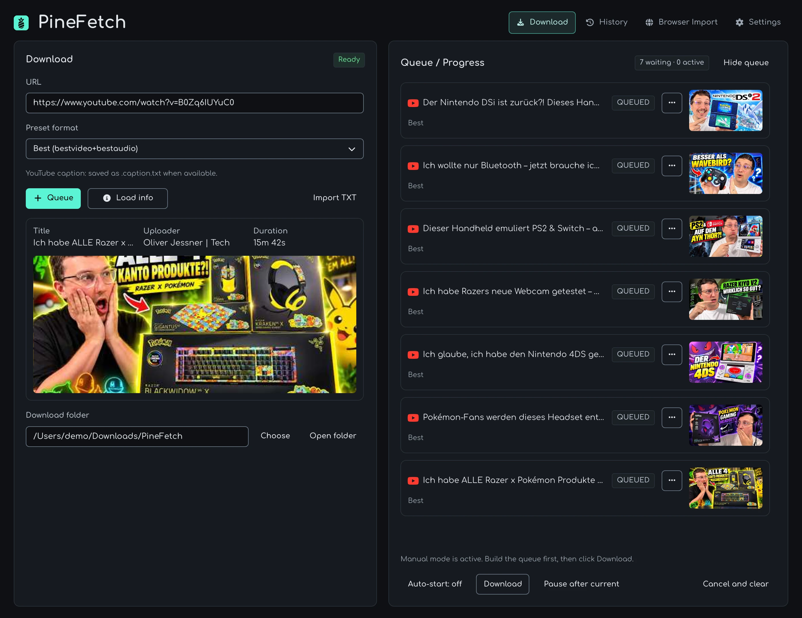
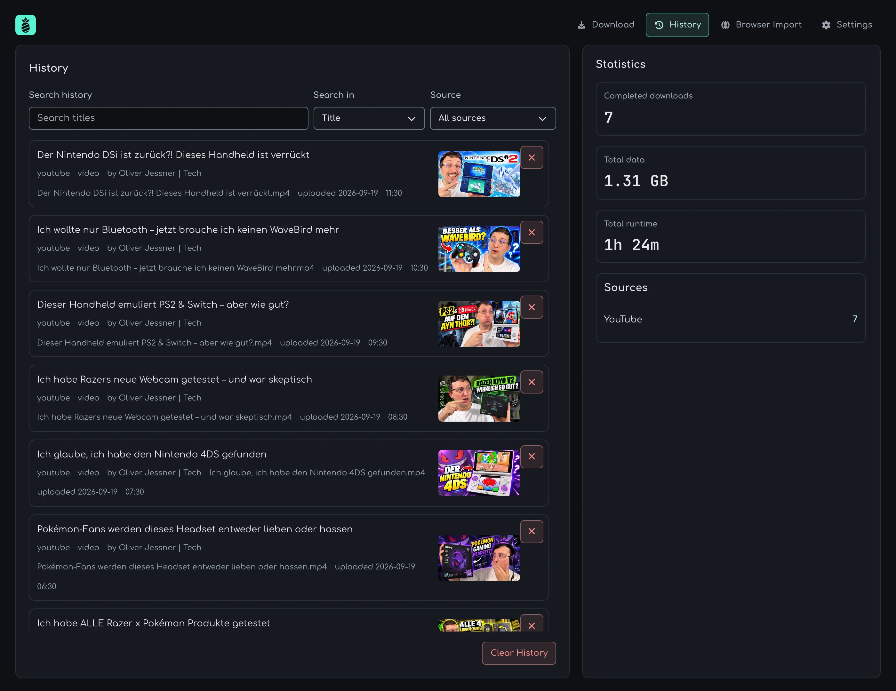
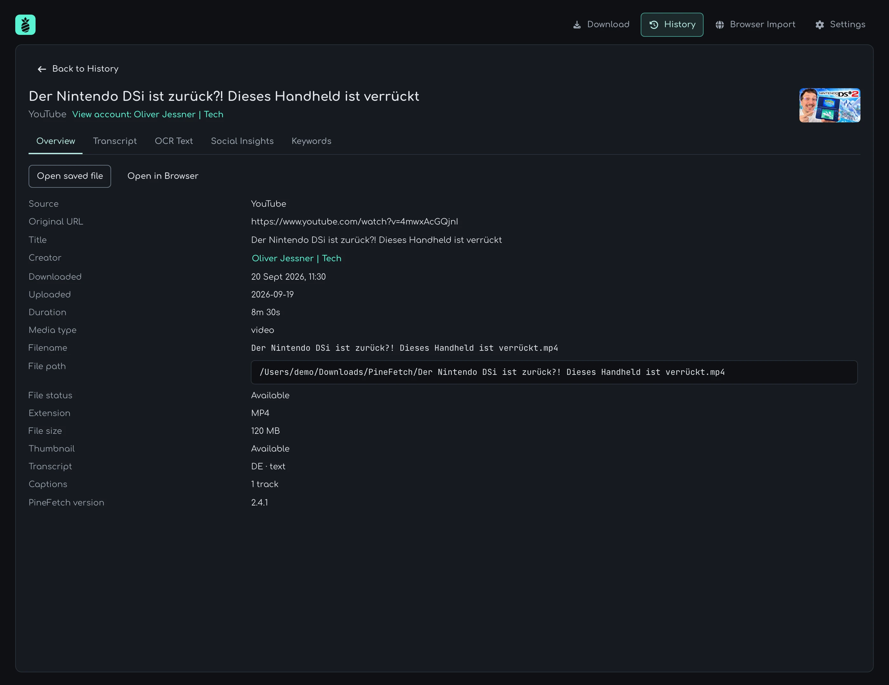
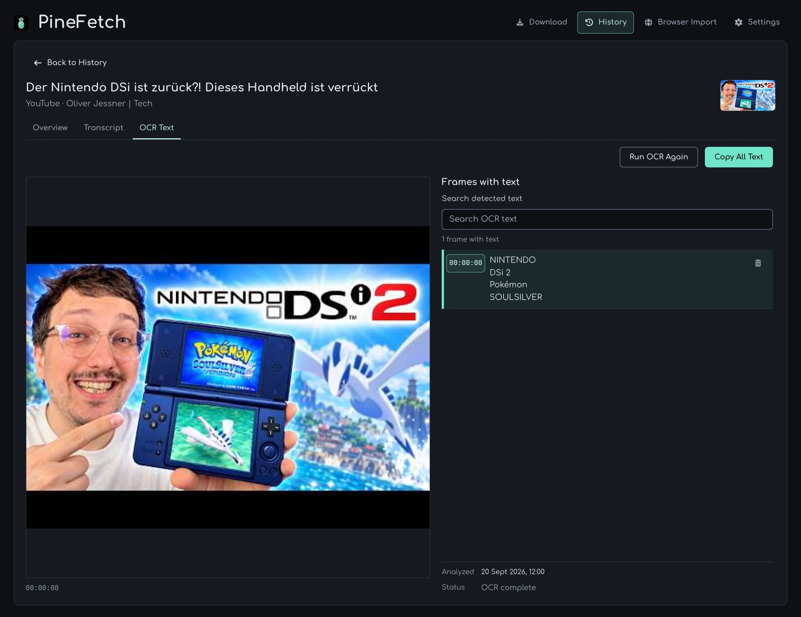
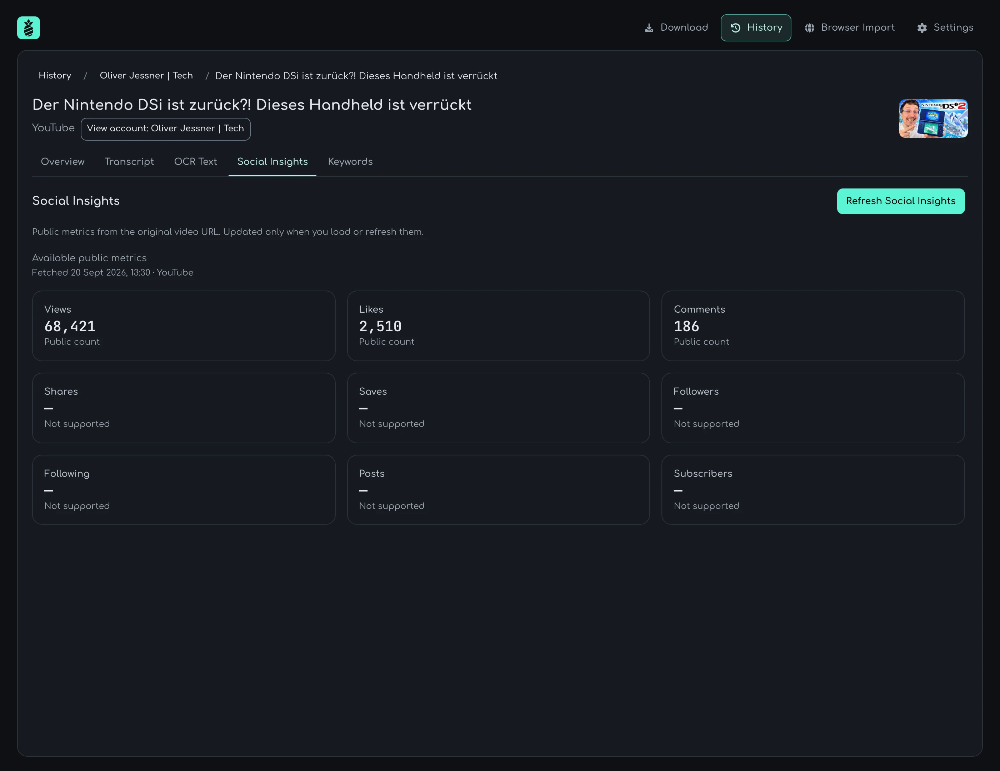
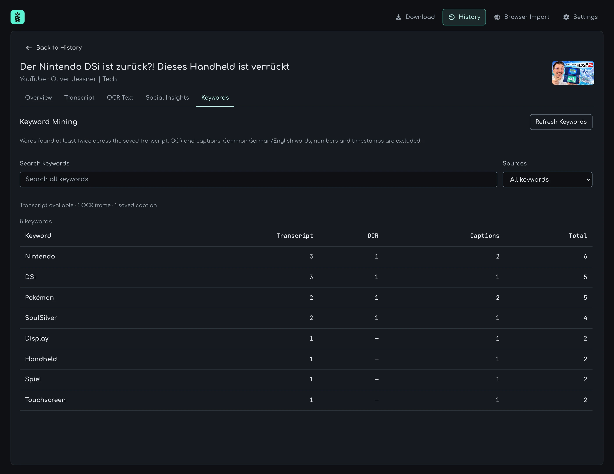
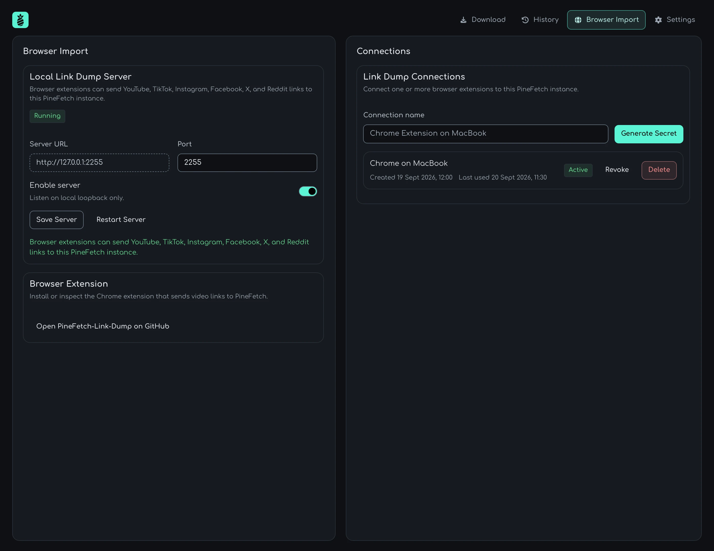
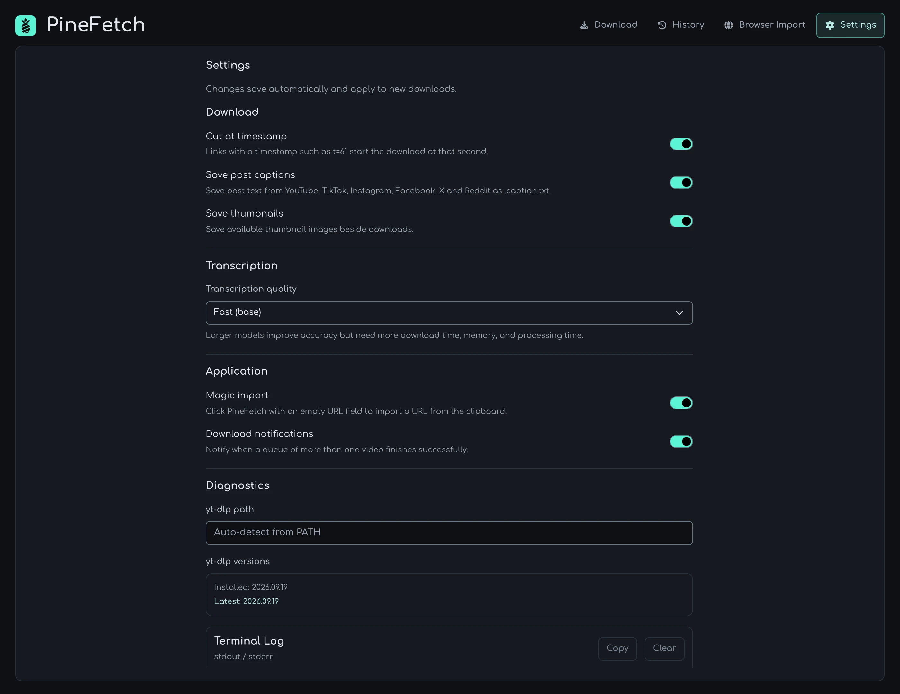

# PineFetch 🍍

[](https://github.com/oliverjessner/PineFetch/actions/workflows/dependabot/dependabot-updates) [](https://github.com/oliverjessner/PineFetch/actions/workflows/quality.yml)

**Download videos, audio, captions and transcripts without fighting the command line.**

PineFetch is a local-first desktop app built around [yt-dlp](https://github.com/yt-dlp/yt-dlp).

Paste a link, choose what you want, and PineFetch takes care of the rest.

No account. No cloud. Your files stay on your machine.



## What it does

- Download videos from YouTube, TikTok, Instagram, Facebook, Twitch, X and other sites supported by yt-dlp
- Save post text from YouTube, TikTok, Instagram, Facebook, X and Reddit beside downloads and in the local SQLite database
- Optionally save thumbnail images beside downloads
- Extract MP3 or Opus audio
- Create local transcripts with Whisper
- Generate transcripts with timestamps
- Queue multiple downloads
- Paste YouTube playlist links to add all available videos to the queue
- Import lists of links from TXT files
- Keep a local download history
- Inspect stored metadata, transcripts and captions from History
- Mine keywords locally across saved transcripts, OCR and captions ([details](docs/KEYWORDS.md))
- Open accounts from History details to browse saved videos and public profile videos ([details](docs/ACCOUNTS.md))
- Load public Social Insights on demand and keep snapshots in SQLite ([details](docs/SOCIAL_INSIGHTS.md))
- Control PineFetch from the command line
- Send links to PineFetch through its local Link Dump API

PineFetch is intentionally local-first. Downloads, transcripts and history stay on your computer.

See the [video and caption compatibility list](docs/COMPATIBILITY.md) for accepted links and caption behavior.

## Install

### macOS

```bash
brew tap oliverjessner/tap
brew install --cask oliverjessner/tap/pinefetch
```

Or download from the [releases](https://github.com/oliverjessner/PineFetch/releases).

## Presets

Pick what you need:

`Best` · `Max 1080p` · `MP3` · `Opus` · `Text` · `Text with timestamps`

Transcription runs locally using `faster-whisper`.

You can choose between faster or more accurate Whisper models in Settings.

## Queue, history and batch imports

Drop in one link or queue a whole list.

Pasting a YouTube playlist link into the Download URL field automatically adds its
available videos as separate jobs, in playlist order. Video links containing
`list=` and Magic Import work too. Each job uses the selected format and download
folder; queue auto-start and pause settings still apply. Private, deleted and
invalid entries are skipped with a count. A video-specific timestamp in the pasted
playlist link does not trim every video in the playlist.

PineFetch can import YouTube, TikTok and Instagram URLs from a simple TXT file and process them one after another.

Your completed downloads are stored in a local history with useful stats like total downloads, storage used and runtime.



Open a History entry to inspect its metadata, transcript and saved caption tracks in a full-width detail view. Breadcrumbs link to its account and back to **History**, preserving your filters, loaded entries and scroll position. **Open OCR** in the context menu opens the OCR tab; **Start OCR Analysis** starts local Apple Vision analysis on macOS. Analyses keep running while you use other views, and OCR status appears in History. Saved text can be searched and copied. Each sampled frame with text is one OCR result containing all recognized blocks. Search covers all saved frames while the viewer loads pages of 100. Select a frame result to preview it; **Delete frame text** removes all OCR text of that frame after confirmation. **Copy All Text** exports every saved frame, regardless of the current search or page. Transcript, caption and OCR content is loaded on demand.





**Social Insights** loads public video metrics when you click its load or refresh button and saves the snapshot locally.



**Keywords** compares word occurrences across the saved transcript, all OCR frames and captions, including only words found at least five times in total, sorted by Total descending. Search terms, filter by source or show words present in all three. Counts update when you reopen the tab or select **Refresh Keywords**.



## CLI

The desktop app also includes a command-line interface.

```bash
PineFetch queue add --link 'https://www.youtube.com/watch?v=VIDEO_ID'
PineFetch queue list
PineFetch history list
PineFetch stats
```

See the [CLI documentation](docs/CLI.md) for all available commands.

## Link Dump

PineFetch can receive links from browser extensions, scripts and other local tools through its Link Dump API.

Everything runs locally on:

```text
http://127.0.0.1:2255
```

Connections are protected with a locally generated secret.



## Build it yourself

You'll need Node.js, Rust, Tauri and yt-dlp. Social Insights bundles portable Node 26 and Fetchary during `npm run dev`/`npm run build:check`/app builds. The first preparation downloads the checksum-verified Node runtime and installs locked production dependencies; later runs reuse it.

```bash
git clone https://github.com/oliverjessner/PineFetch.git
cd PineFetch

npm ci
npm run dev
```

The interface uses [oj-designsystem](https://github.com/oliverjessner/oj-designsystem).
`npm ci` prepares its complete local stylesheet, JavaScript, fonts, icons and
license notices for Tauri. No font or icon CDN is needed.

The shared logo source is `src/images/logo.png`. After replacing it, run
`npm run sync:icons` to regenerate the favicon and desktop icons for macOS,
Windows and Linux, then `npm run screenshots` to refresh the README screenshots.
The logo has transparent outer corners. Desktop icons add a centered transparent
margin, with the artwork occupying 824 pixels of the 1024-pixel canvas.

Create a macOS release build with:

```bash
npm run build
```

Release notes are available in the [changelog](docs/changelog.md).

Run `npm run check` before submitting changes. Toolchain setup, individual checks,
the compile/link build check, and required CI gates are described in the
[development guide](docs/DEVELOPMENT.md).

## Settings

PineFetch lets you configure things like:

- Output folder
- yt-dlp path
- Transcription quality
- Keep video with transcript
- Cut downloads at timestamps
- Magic clipboard import



## A small note

PineFetch is made for content you own or have permission to download.

Please respect platform terms and local laws. PineFetch does not attempt to bypass DRM or paywalls.

## Built with

[yt-dlp](https://github.com/yt-dlp/yt-dlp) · [FFmpeg](https://ffmpeg.org/) · [oj-designsystem](https://github.com/oliverjessner/oj-designsystem) · Tauri · Rust

## License

MIT
